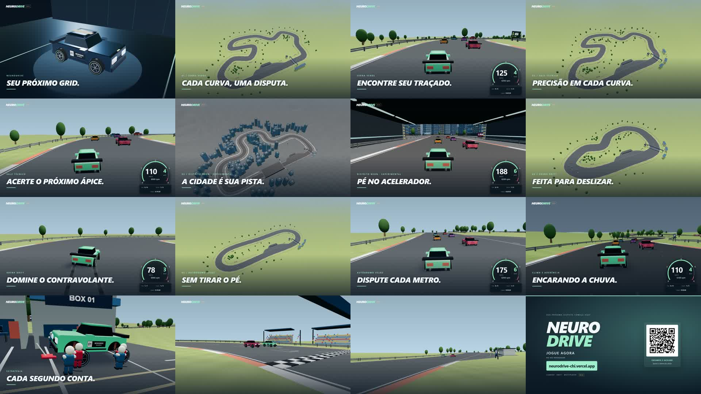

<div align="center">

# NEURO<br>DRIVE

**Seu carro. Sua disputa. Seus amigos.**

Corrida 3D no navegador · Multiplayer para até 6 jogadores · Drift · Laboratório de IA

**[🏁 JOGUE AGORA](https://neurodrive-chi.vercel.app/)** · [Jogar no pendrive](JOGAR-NO-PENDRIVE.md) · [Executar localmente](#executar-localmente)

**BETA — um projeto independente em evolução.**

</div>

## Assista ao trailer

[](https://github.com/Dioguinho-max/neurodrive/raw/refs/heads/main/docs/media/neurodrive-trailer.mp4)

<div align="center">

**[▶ ABRIR O TRAILER EM FULL HD](https://github.com/Dioguinho-max/neurodrive/raw/refs/heads/main/docs/media/neurodrive-trailer.mp4)**

1080p · 60 FPS · 62 segundos · MP4, aproximadamente 42 MB

Clique na imagem ou no link para abrir/baixar o vídeo. O encerramento inclui um QR code para jogar.

</div>

## O que é o NeuroDrive?

O NeuroDrive começou com carros aprendendo a dirigir por meio de redes neurais. Hoje é um jogo de corrida para navegador, feito para se divertir com amigos: classificação, disputas contra IA, campeonatos, desafios de drift, chuva e estratégia nos boxes. O laboratório de IA continua disponível para explorar a origem do projeto.

A pilotagem tem estilo **arcade**, com câmbio, aderência, desgaste de pneus e vácuo. O jogo funciona com teclado, controles de toque e controles de videogame compatíveis, com opções gráficas para diferentes computadores e celulares.

## Escolha sua disputa

| Modo | O que você encontra |
| --- | --- |
| **Corrida solo** | Classificação para definir o grid, cinco adversários de IA, dificuldades selecionáveis e provas curtas ou longas. |
| **Campeonato** | Etapas e pontuação acumulada. No online, votação da próxima pista e anúncio do campeão. |
| **Multiplayer** | Salas por código para até seis jogadores, convites por link ou QR code e revanche na mesma sala. |
| **Desafio Drift** | Dois minutos para conectar derrapagens, multiplicar pontos e buscar medalhas e recordes. Freio de mão e acertos Estável/Solto. |
| **Desafios entre amigos** | Corrida de uma volta, melhor volta e duelo de drift, com placar da sessão. |
| **Copa Neuro** | Disputa online por moedas virtuais do jogo. |
| **Laboratório de IA** | Carros treinando por neuroevolução, sensores visíveis e rede neural que pode ser pausada e inspecionada. |

Os bots da corrida usam um controlador próprio para curvas, ultrapassagens e paradas. Eles são independentes das redes que aprendem no laboratório.

## Cinco circuitos, diferentes desafios

| Circuito | Identidade |
| --- | --- |
| **Serra Verde** | Curvas variadas, vegetação e mudanças de relevo. |
| **Autódromo Veloz** | Retas longas e curvas abertas para disputar velocidade e vácuo. |
| **Vale Técnico** | Traçado sinuoso, mudanças de direção e precisão nas curvas. |
| **Arena Drift** | Pista larga, curvas conectadas e relevo suave, dedicada ao Drift. |
| **Distrito Neon — experimental** | Circuito urbano com prédios, túnel iluminado, calçadas e uma reta longa. |

O Distrito Neon ainda está em avaliação: não concede moedas nem envia marcas aos rankings competitivos. Os campeonatos existentes usam os três circuitos principais.

## Dentro e fora da pista

- **Pilotagem:** quatro opções de carro com características diferentes, seis marchas, marcha ré, câmbio automático/manual, freio progressivo e vácuo nas corridas.
- **Clima e estratégia:** tempo seco, chuva ou clima variável; pista molhando gradualmente, pneus de seco e de chuva, desgaste e risco de furo.
- **Pit stops animados:** entrada automática, limite de velocidade, carro levantado e mecânicos trocando os pneus. A IA também planeja paradas.
- **Apresentação:** panorâmicas, previsão do tempo, painel de velocidade/RPM, tempos por setor, rádio da equipe e cerimônia de pódio dentro do autódromo.
- **Perfil do piloto:** foto, nick, estatísticas, conquistas, histórico e moedas virtuais.
- **Garagem:** pinturas cosméticas, loja e prévia 3D que permite girar o carro. As pinturas não alteram o desempenho.
- **Recordes:** melhores voltas por circuito, temporadas e histórico; marcas pessoais do solo separadas dos resultados competitivos validados pelo servidor.
- **Áudio:** motor sintetizado, música original da garagem, chuva e vozes de rádio pré-geradas, disponíveis também no pacote offline.
- **Ajustes:** português/inglês, controles de toque, navegação por controle, movimento reduzido, vibração opcional e qualidade gráfica salva.
- **Desempenho:** presets Desempenho, Mais detalhes e Super alto, além de marcador de FPS para acompanhar a fluidez.
- **Uma surpresa escondida:** existe um easter egg. A descoberta fica por sua conta.

Consulte o [guia completo de recursos e regras](GUIA-RECURSOS.md) para detalhes de pneus, pontuação, recompensas, validação de recordes e persistência.

## Como jogar

### Pelo navegador

Abra **[neurodrive-chi.vercel.app](https://neurodrive-chi.vercel.app/)**. É possível experimentar o solo como visitante; use uma conta para os recursos de perfil, loja e multiplayer.

No celular, use os pedais e as setas na tela. Em computadores mais simples, comece pela qualidade **Desempenho**. No online, abrir o menu não pausa a corrida.

### Com amigos na mesma rede

O pacote **NeuroDrive-Pendrive** permite que um computador hospede as partidas. Os demais jogadores acessam o endereço dele pelo navegador — inclusive em celulares e Chromebooks.

1. Prepare o pacote e copie a pasta inteira para o computador hospedeiro ou pendrive.
2. No Windows, execute `INICIAR-JOGO.cmd`; no Linux x64 compatível, use `INICIAR-JOGO-LINUX.sh`.
3. Todos acessam **o mesmo IP e a mesma porta** mostrados na janela, usando contas diferentes.
4. Crie uma sala, compartilhe o código e marque os pilotos como prontos.

O pacote preparado inclui Node.js portátil e funciona sem internet. Contas e moedas ficam no banco local, separadas das contas do site. Uma sala comporta até **seis jogadores, incluindo o hospedeiro**. A rede precisa permitir a comunicação entre os dispositivos.

**[Passo a passo para Windows e Linux, geração do pacote e backup →](JOGAR-NO-PENDRIVE.md)**

## Controles

| Ação | Teclado | Xbox / PlayStation |
| --- | --- | --- |
| Acelerar / frear | W / S ou ↑ / ↓ | RT / LT · R2 / L2 |
| Virar | A / D ou ← / → | Analógico esquerdo |
| Subir / reduzir marcha | E / Q | RB / LB · R1 / L1 |
| Freio de mão no Drift | Espaço | A / ✕ |
| Chamar / cancelar boxes | B | X / □ |
| Recuperar carro | R | Y / △ |
| Menu | Esc | Start / Options |
| Pausar no solo | P | Menu / pausa |

No automático, pare e mantenha o freio pressionado para engatar a ré. No manual, reduza da primeira para **R** com o carro parado. O suporte a controles depende do reconhecimento pelo navegador; há também controles de toque na tela.

## Executar localmente

Requisito: **Node.js 22, versão 22.13.0 ou superior dentro da série 22**, conforme `package.json`.

```bash
npm ci
npm start
```

Abra **http://127.0.0.1:3000**. Esse comando inicia o servidor local com contas SQLite, loja e corrida solo. No PowerShell, se `npm.ps1` estiver bloqueado, use `npm.cmd` no lugar de `npm`.

Para hospedar o multiplayer na rede local, encerre o servidor anterior e execute:

```bash
npm run start:lan
```

Os amigos usam o IP exibido no terminal. Os dados locais ficam em `server/data/neurodrive.sqlite`.

| Comando | Finalidade |
| --- | --- |
| `npm run build` | Gerar o frontend em `dist/`. |
| `npm run build:portable` | Preparar o pacote portátil para Windows x64. |
| `npm run build:portable:linux` | Preparar o pacote com Node portátil também para Linux x64. |
| `npm run start:cloud` | Iniciar o backend PostgreSQL com as variáveis de ambiente configuradas. |
| `npm test` | Executar a bateria de testes do projeto. |

Para publicar frontend e backend, siga **[DEPLOY.md](DEPLOY.md)**. Configurações, bancos locais e credenciais não devem ser enviados ao repositório.

## Por dentro do projeto

| Camada | Tecnologias |
| --- | --- |
| Interface | HTML, CSS e JavaScript |
| Renderização 3D | Three.js, modelos e cenários construídos em código |
| Som | Web Audio API e arquivos de voz pré-gerados |
| Servidor local | Node.js e SQLite |
| Multiplayer e cloud | Node.js, WebSocket e PostgreSQL |
| Publicação | Vercel, Render e Supabase |

O servidor controla a simulação online, os resultados, as compras e as recompensas. O navegador antecipa os comandos do próprio carro e suaviza as atualizações recebidas. A latência da rede e o desempenho do dispositivo influenciam a experiência.

```text
output/                Código-fonte do frontend, assets e testes
server/                Servidores, contas, banco e simulação online
scripts/               Build, pacote portátil e ferramentas
docs/media/            Trailer e prévia usados neste README
dist/                  Frontend gerado, ignorado pelo Git
NeuroDrive-Pendrive/    Pacote portátil gerado, ignorado pelo Git
```

Edite os arquivos em `output/` e gere o build; `dist/` é a saída da publicação. O trailer fica em `docs/media/` e não é copiado para o jogo pelo build atual.

## Documentação e qualidade

- [Guia de recursos, regras e limitações](GUIA-RECURSOS.md)
- [Jogar e hospedar pelo pendrive](JOGAR-NO-PENDRIVE.md)
- [Publicação e variáveis de ambiente](DEPLOY.md)
- [Revisão de qualidade e limites dos testes](REVISAO-QUALIDADE.md)
- [Produção do trailer](TRAILER.md)
- [Créditos das vozes do rádio](output/assets/radio/CREDITS.md)

Os testes cobrem física, contas, menus, multiplayer, pneus, clima e outros recursos. Parte usa DOM ou renderização simulada; a avaliação visual e a experiência em aparelhos reais continuam importantes.

## Sobre o projeto e créditos

Criado por **[Diogo](https://github.com/Dioguinho-max)** para aprender, experimentar e se divertir com amigos. O NeuroDrive reúne entretenimento e um laboratório didático de redes neurais em um mesmo projeto.

As moedas são virtuais, sem compras com dinheiro real. O projeto está em beta; não é um simulador profissional de automobilismo.

As licenças de [Three.js](output/vendor/THREE-LICENSE.txt), do [gerador de QR code](output/vendor/QRCODE-LICENSE.txt) e os [créditos de voz](output/assets/radio/CREDITS.md) estão preservados. Uma licença própria para o código do NeuroDrive ainda não foi definida neste repositório.
